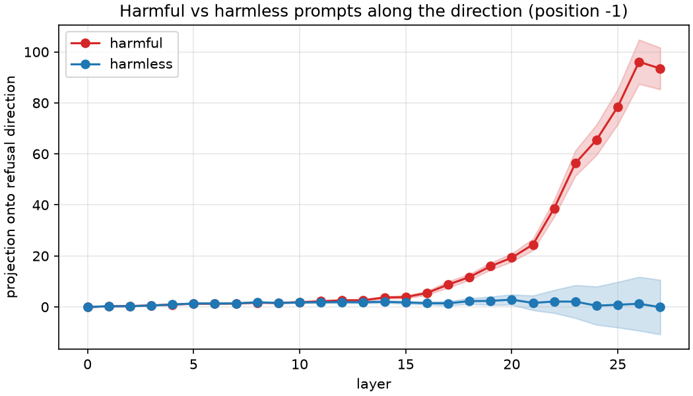
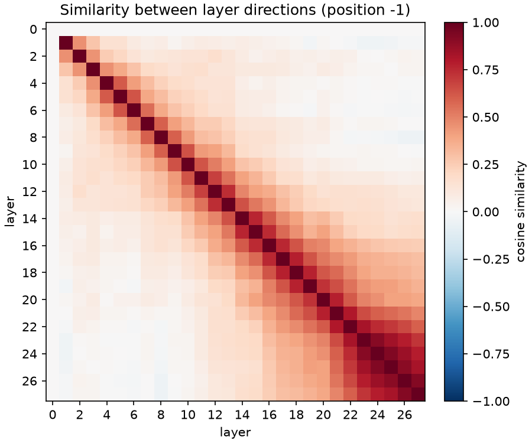
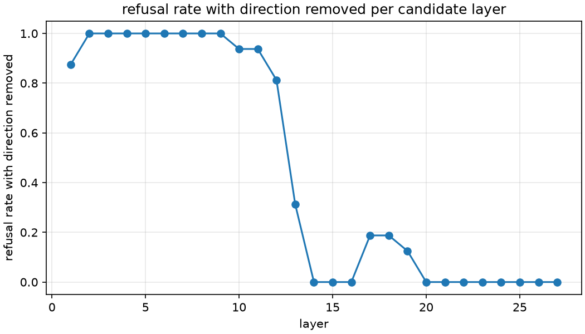

# refusal-lens

[](https://github.com/fahd04/refusal-prob/actions/workflows/ci.yml)


A local toolkit for analyzing and editing refusal behavior in open-weight LLMs
(Qwen2.5, Llama 3.2).

> **Status:** alpha. The full pipeline (analyze → ablate → evaluate → export)
> works end to end on Qwen2.5-1.5B-Instruct. On held-out prompts, removing one
> direction cuts refusals from **100% to 5%** with a harmless-prompt KL of
> **0.089** ([results](#evaluation)).

## Overview

Instruction-tuned models decide whether to refuse a request, and research has
shown that this behavior is largely mediated by a single direction in the
residual stream. refusal-lens makes that direction something you can measure,
look at and edit:

1. **Record** residual-stream activations on harmful and harmless prompts.
2. **Compute** a refusal direction per layer as the difference of means.
3. **Visualize** how the direction emerges and changes across layers.
4. **Ablate** it with inference-time hooks, or permanently by orthogonalizing
   the weights that write to the residual stream.
5. **Evaluate** refusal rate, KL divergence on harmless prompts, and
   capability retention.
6. **Export** the edited model as safetensors or GGUF.

Everything runs locally. It is developed on an Apple M4 Pro (MPS, 24 GB) and
also supports CUDA and CPU.

| Module | Purpose |
| --- | --- |
| `config` | Pydantic run config loaded from YAML; seeding; resolved-config snapshots |
| `device` | Device (`mps` → `cuda` → `cpu`) and dtype selection |
| `models` | Model/tokenizer loading, per-architecture adapters |
| `prompts` | Harmful/harmless prompt sets, chat templates |
| `activations` | Residual-stream recording via forward hooks |
| `directions` | Difference-of-means refusal directions |
| `ablation` | Hook-based ablation and weight orthogonalization |
| `evaluate` | Refusal rate, KL divergence, capability benchmark |
| `visualize` | Plots across layers and prompts |
| `export` | safetensors and GGUF (via llama.cpp) |
| `cli` | `refusal-lens` Typer CLI |

## Installation

Requires Python 3.11+ and [uv](https://docs.astral.sh/uv/).

```bash
git clone https://github.com/fahd04/refusal-prob.git
cd refusal-prob
uv sync                     # creates .venv with runtime + dev dependencies
uv run refusal-lens --help
```

**Apple Silicon.** Some PyTorch operators are not implemented on MPS yet. Set
this before running so they fall back to the CPU instead of raising:

```bash
export PYTORCH_ENABLE_MPS_FALLBACK=1
```

refusal-lens warns at startup if MPS is selected without it.

**CUDA.** On Linux, `uv sync` installs CPU-only PyTorch so CI and CPU machines
don't download multi-GB CUDA wheels. To use a GPU, replace it with a CUDA
build that matches your driver, e.g.:

```bash
uv pip install --reinstall torch --index-url https://download.pytorch.org/whl/cu124
```

**GGUF export** needs a local [llama.cpp](https://github.com/ggml-org/llama.cpp)
checkout (`git clone https://github.com/ggml-org/llama.cpp`); no build is
required. Point `export.llama_cpp_dir` in your config at it. Its converter runs
in this project's environment, which already includes what it needs (torch,
transformers, sentencepiece).

### Development

```bash
uv run pre-commit install   # ruff + mypy on every commit
uv run ruff check . && uv run ruff format --check .
uv run mypy                 # strict on src/
uv run pytest               # CPU only, tiny random models, no downloads
```

## Quickstart

Four commands, each building on the previous one's output. Times are for
Qwen2.5-1.5B-Instruct on an M4 Pro; the model and datasets download on first
use.

```bash
export PYTORCH_ENABLE_MPS_FALLBACK=1
uv run refusal-lens analyze  --config configs/qwen2.5-1.5b.yaml   # ~25 s
uv run refusal-lens ablate   --config configs/qwen2.5-1.5b.yaml   # ~1 min
uv run refusal-lens evaluate --config configs/qwen2.5-1.5b.yaml   # ~1 min
uv run refusal-lens export   --config configs/qwen2.5-1.5b.yaml   # GGUF: ~1 min
```

| Command | What it does | Writes to `outputs/<name>/` |
| --- | --- | --- |
| `analyze` | Records activations, computes a direction per layer, scores and plots them | `directions.safetensors`, `analysis.json`, `plots/` |
| `ablate` | Tries each layer's direction, picks the best, removes it | `ablation.json`, `plots/ablation_*.png`, `edited_model/` |
| `evaluate` | Compares base and edited model on held-out prompts | `evaluation.json` |
| `export` | GGUF via llama.cpp, plus an Ollama `Modelfile` | `export/<name>-<outtype>.gguf`, `export/Modelfile` |

`ablation.method` chooses how the direction is removed: `orthogonalize`
(default) edits the weights and saves a standalone model; `hook` removes it at
inference time and saves no weights (useful for quick experiments; nothing to
export). Set `ablation.direction_layer` to skip the layer search.

To run the exported model locally with [Ollama](https://ollama.com):

```bash
ollama create qwen-ablated -f outputs/qwen2.5-1.5b-instruct/export/Modelfile
ollama run qwen-ablated
```

Ollama also serves an OpenAI-compatible API at `http://localhost:11434/v1`, so
any client that accepts a custom base URL can use the edited model.

Each run writes `resolved_config.yaml` first: the full config with defaults
filled in, plus the refusal-lens and torch versions. Passing that file back
with `--config` reproduces the run. Seeds come from the config's `seed` field;
set `deterministic: true` to also request deterministic kernels. Keep
machine-specific settings (such as `llama_cpp_dir`) in a
`configs/*.local.yaml` copy, which git ignores.

## How it works

**1. Record activations.** Prompts are wrapped in the model's chat template and
run in left-padded batches. Forward pre-hooks on every decoder layer capture
the residual stream at the last prompt token, the position right before the
model starts its answer. `resid[l]` is the *input* to layer `l` (so `resid[0]`
is the token embedding), which matches Hugging Face's `hidden_states[l]`.
Position ids are computed from the attention mask, so padding doesn't change a
prompt's activations.

**2. Compute directions.** For each layer, the candidate refusal direction is
the difference of means between harmful and harmless prompts:

```
r[l] = mean(resid_harmful[l]) − mean(resid_harmless[l])
```

Averaging over many prompts cancels topic-specific content; what remains is
what harmful requests share. `analyze` scores each layer on held-out prompts by
how cleanly the direction separates the two groups (Cohen's d of the
projections).

**3. Remove a direction.** With unit direction `r̂`, directional ablation
projects it out of every vector written to the residual stream:

```
x ← x − (x · r̂) r̂
```

Only three kinds of module write to the residual stream: the token embedding,
each layer's attention output projection and each layer's MLP down projection.
`hook` mode applies the projection to their outputs at run time.
`orthogonalize` mode bakes it into their weights:

```
W_out ← W_out − r̂ r̂ᵀ W_out      (nn.Linear, [d_model, d_in])
W_emb ← W_emb − W_emb r̂ r̂ᵀ      (embedding, [vocab, d_model])
```

The two modes produce the same model, and the test suite checks this on both
architectures. When the output layer shares its weights with the embedding
(tied embeddings, as in Qwen2.5-1.5B and Llama 3.2 1B/3B), it is untied first
so editing the embedding doesn't silently change the output layer.

**4. Choose the layer.** `ablate` removes each layer's direction in turn (with
hooks) and measures two things on a few *train* prompts: the harmful refusal
rate, and the KL divergence of the next-token distribution on harmless prompts
(how much normal behavior changed). It picks the lowest refusal rate and breaks
ties by lowest KL.

**5. Evaluate and export.** `evaluate` compares the base and edited models on
the held-out *eval* prompts, which play no part in computing or choosing the
direction. `export` converts the edited checkpoint to GGUF with llama.cpp's
converter.

**Architectures.** Each supported model family has a small adapter that tells
the pipeline where the decoder layers, embedding and residual writers are.
Qwen2 and Llama share one (`LlamaStyleAdapter`); adding a family means
subclassing `ArchitectureAdapter`.

## Evaluation

Qwen2.5-1.5B-Instruct ([`configs/qwen2.5-1.5b.yaml`](configs/qwen2.5-1.5b.yaml),
seed 42), on an M4 Pro (MPS, bf16). Prompts come from
[`mlabonne/harmful_behaviors`](https://huggingface.co/datasets/mlabonne/harmful_behaviors)
and [`mlabonne/harmless_alpaca`](https://huggingface.co/datasets/mlabonne/harmless_alpaca):
128 + 128 train prompts compute the directions, 16 + 16 of them choose the
layer, and 64 + 64 held-out eval prompts produce the numbers below.

### Where refusal appears



Projected onto the layer-26 direction (the one with the clearest separation),
harmful and harmless prompts are indistinguishable in early layers and
separate sharply from about layer 14.
The separation score (Cohen's d) rises from about 4 at layer 13 to 9.5 by
layer 19 and stays there.



Directions from layers 14–27 are similar to each other and unlike those from
early layers: the refusal feature forms in the middle of the network and is
carried forward.

### Which direction to remove

| Direction from layer | Refusal rate when removed | Harmless KL |
| --- | --- | --- |
| 1–12 | 81–100% | 0.02–0.35 |
| 13 | 31% | 0.17 |
| 14–16 | 0% | 0.48–1.40 |
| 17–19 | 13–19% | 0.04–0.07 |
| 20 | 0% | 1.17 |
| **21 (selected)** | **0%** | **0.060** |
| 22–27 | 0% | 0.06–0.12 |



Layer 14 is the first direction whose removal stops refusals, but it also
changes harmless behavior the most. The layer-21 direction stops them with the
smallest change. The layer where refusal is easiest to *detect* (26, highest
separation) isn't the one that's best to *remove*.

### Result on held-out prompts

| Metric (64 + 64 eval prompts) | Base | Edited (layer 21, orthogonalized) |
| --- | --- | --- |
| Harmful prompts refused | 100% | **4.7%** |
| Harmless prompts refused | 9.4% | 3.1% |
| KL on harmless prompts (next token) | 0 | **0.089** |

Harmless "refusals" are false positives of the keyword detector (for example a
normal answer that contains "I cannot"); they show its noise level. The
exported q8_0 GGUF is 1.8 GB and runs in Ollama.

Not yet measured: capability benchmarks (`evaluation.capability_benchmark` is
not implemented), and models other than Qwen2.5-1.5B.

## Intended use

refusal-lens is meant for interpretability and safety research: understanding
how refusal is represented inside a model, how robust safety fine-tuning is,
and how weight edits change model behavior. It is also an educational
reference implementation of published techniques.

## Limitations

- **Edited models are less safe.** Removing the refusal direction removes a
  safety mechanism. An edited model will comply with harmful requests it
  previously refused. Do not deploy edited models in user-facing products, and
  do not use them to cause harm. You are responsible for what you do with them.
- **Refusal is not only one direction.** The single-direction picture is a
  strong approximation. Some refusal behavior can remain, and edits can
  degrade unrelated capabilities.
- **Evaluation is approximate.** Detecting refusals by string matching misses
  some refusals and flags some non-refusals. KL divergence and small
  benchmarks only partly capture capability loss.
- **Scope.** Only Qwen2/Qwen2.5 and Llama 3.x architectures have adapters, and
  development targets small models that fit on a single consumer machine.
- **Numerics.** Results can differ slightly between MPS, CUDA and CPU, and
  between dtypes.

## Related work

- Arditi, A., Obeso, O., Syed, A., Paleka, D., Panickssery, N., Gurnee, W., &
  Nanda, N. (2024). *Refusal in Language Models Is Mediated by a Single
  Direction.* [arXiv:2406.11717](https://arxiv.org/abs/2406.11717).
  The method refusal-lens implements.
- FailSpy, [abliterator](https://github.com/FailSpy/abliterator): an early
  library for "abliteration" built on TransformerLens.
- Sumandora, [remove-refusals-with-transformers](https://github.com/Sumandora/remove-refusals-with-transformers):
  a minimal implementation using plain Hugging Face transformers.
- [Heretic](https://github.com/p-e-w/heretic): automated refusal removal that
  tunes ablation parameters with optimization.

## License

Code is released under the [Apache License 2.0](LICENSE).

**Model licenses still apply.** refusal-lens does not ship model weights. Any
model you edit or export with it remains subject to the original model's
license and acceptable-use policy (for example the Qwen license or the Llama 3.2
Community License). Check those terms before you share or use an edited model.
